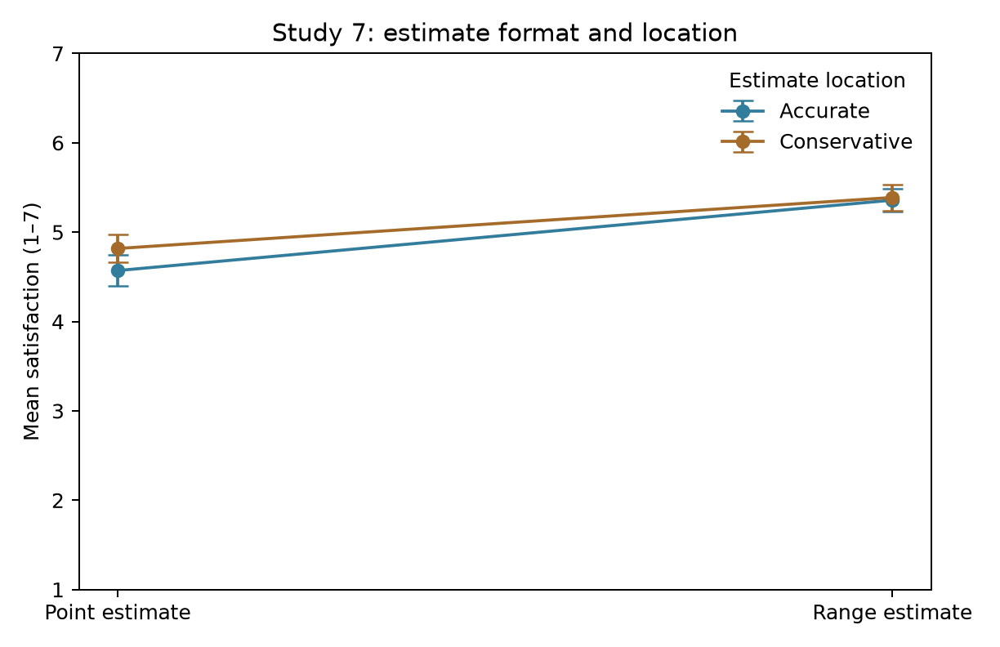

# Replication of time estimate experiments

## 1 Paper summary

Hu, Gaertig, and Dietvorst (2025) examine how platforms should communicate uncertain completion times. Their question is whether customers evaluate a service more favorably when it provides a point estimate, such as 45 minutes, or a range, such as 35–55 minutes. The argument is that ranges can accommodate uncertain outcomes and reduce perceived expectation violations, but excessively wide ranges sacrifice useful information. This question is relevant to information systems because the presentation of an algorithm’s prediction may influence users’ evaluations even when underlying service performance is unchanged.

The authors test three hypotheses. H1 predicts higher satisfaction with range estimates than point estimates after outcomes are revealed. H2 predicts that excessively wide ranges reduce satisfaction relative to reasonably wide ranges or point estimates. H3 predicts that ranges increase satisfaction by reducing perceived expectation violations. Later experiments also examine whether ranges outperform conservative point estimates and whether the findings extend to GPS estimates.

The evidence comes from eight preregistered online experiments using participants recruited through Amazon Mechanical Turk or Prolific. Their final samples contain 698, 599, 479, 392, 468, 801, 998, and 888 participants, respectively, totaling 5,323 observations. The authors’ public materials include participant-level data, Stata code, codebooks, experimental materials, and preregistrations (Hu et al., 2025). This project uses the archived replication package rather than collecting new data.

In Studies 1–3 and 5–8, participants observe estimates and outcomes for 20 food deliveries or GPS trips. The main dependent variable averages five seven-point items assessing liking, informativeness, usefulness, perceived accuracy, and trust. Study 5 also measures perceived unexpected lateness. Study 4 instead examines participants’ choice between point- and range-estimate models for an incentivized slider task. The unit of analysis is the participant; the 20 observed outcomes are not treated as 20 independent satisfaction observations.

Random assignment of estimate conditions identifies differences in evaluations within each experiment. Studies 1–2 use ordinary least squares (OLS) regressions with condition indicators and alternate reference groups to estimate pairwise differences. Study 1 compares point, narrow-range, and moderate-range estimates. Study 2 introduces a much wider range, testing the proposed limit to the benefit. Study 3 varies estimates and outcomes across trials. Study 4 uses a linear probability model, logistic regression, and a binomial test of model choice.

Study 5 estimates satisfaction and lateness regressions and bootstraps the indirect effect using 1,000 resamples. Because lateness perceptions are measured rather than randomized, the mediation analysis supports the proposed explanation without independently identifying a causal mediator effect. Study 6 compares ranges with accurate, optimistic, and conservative point estimates. Study 7 crosses format with estimate location and includes their interaction. Study 8 examines short and long GPS trips; pooled regressions control for trip duration. Together, these designs test both the range benefit and qualifications concerning width, conservatism, and setting.

## 2 Replication of main results

The replication translated the central analyses in the authors’ Stata scripts into Python using pandas, NumPy, SciPy, and statsmodels. The translation preserved condition coding, exclusion rules, outcome construction, and conventional OLS standard errors. Participant-level Excel files were read directly, so conversion to a different data format was unnecessary. The analysis reproduced the main satisfaction, model-choice, and mediation results across all eight studies, along with the descriptive statistics in published Tables 2, 4, and 5 and the statistical content of Figure 7. It did not reproduce every supplemental result.

All eight final sample sizes matched the paper. The 31 targeted regression coefficient/standard-error pairs agreed at the paper’s reported two-decimal precision. All 19 checked means and standard deviations in Tables 2, 4, and 5 also matched. Appendix Tables A1–A4 provide numerical results and published-value comparisons; Figure A1 reproduces the Study 7 pattern.

The central findings were preserved. In Study 1, moderate ranges increased satisfaction by 0.562 points relative to point estimates (SE = 0.105). In Study 2, moderate ranges increased satisfaction by 0.683 points (SE = 0.135), whereas excessively wide ranges reduced satisfaction by 0.303 points relative to point estimates (p = .026). Study 3’s range effect was 0.614 points. In Study 4, 70.7% chose the range model; the logistic odds ratio was 5.88, matching the published result.

Study 5’s total range effect was 0.822 points, while its direct effect after controlling for perceived lateness was 0.132 (p = .286). The estimated indirect effect was 0.689, with a normal bootstrap 95% confidence interval of [0.511, 0.868]. These values round to the published 0.69 and [0.51, 0.87]. Studies 6–7 again favored ranges, including comparisons with conservative point estimates. In Study 8, the pooled range-versus-accurate-point effect was 0.388 points; the long-trip comparison alone was smaller and did not meet the 5% significance threshold (b = 0.245, p = .062).

Several details required attention. Condition numbers differed across studies. Stata’s row-mean command ignores missing items, which required equivalent scale construction in Python. Multi-condition contrasts retained every experimental group so that the pooled residual variance matched the original regression. Study 4 excluded missing choices before duplicate exclusions; Study 8 excluded duplicate IP addresses only because participant IDs were not captured. The main analyses retained end-of-survey attention-check failures, following the original code.

The original mediation bootstrap did not specify a random seed. Python therefore used a documented seed and 1,000 resamples; agreement at printed precision does not imply identical bootstrap draws. More generally, this replication illustrates that software translation requires preserving statistical decisions, not merely replacing commands. Sample-size checks and published-value comparisons made the translation auditable. The replicated evidence supports the authors’ central conclusions within the experimental settings, while leaving field effects on purchases, retention, or repeated real-world use untested.

<!-- ADDITIONAL_ANALYSES -->

## References

Hu, B., Gaertig, C., & Dietvorst, B. J. (2025). How should time estimates be structured to increase customer satisfaction? *Management Science, 71*(9), 7497–7515. https://doi.org/10.1287/mnsc.2023.00137

## Data and reproducibility note

The authors’ public replication materials are available at https://researchbox.org/482 and archived at https://zenodo.org/records/15033033. This report uses secondary data and reports no new participant recruitment. The project preserves the original files and supplies Python scripts, an executable notebook, package versions, and numerical comparison files. AI assistance was used to translate code, run checks, and prepare this draft. The student should verify the notebook results and revise the learning reflection to reflect their own experience. Author contributions, funding, conflicts, and any required course disclosures should be confirmed by the student before submission; none are inferred here.

## A1 Main regression comparisons Studies 1 through 5

| Study | Comparison | Python b | SE | p | Paper b (SE) |
| --- | --- | --- | --- | --- | --- |
| 1 | moderate - point | 0.562 | 0.105 | <.001 | 0.56 (0.10) |
| 1 | narrow - point | 0.503 | 0.105 | <.001 | 0.50 (0.10) |
| 1 | moderate - narrow | 0.059 | 0.104 | 0.571 | 0.06 (0.10) |
| 2 | moderate - point | 0.683 | 0.135 | <.001 | 0.68 (0.13) |
| 2 | wide - moderate | -0.986 | 0.134 | <.001 | -0.99 (0.13) |
| 2 | wide - point | -0.303 | 0.136 | 0.026 | -0.30 (0.14) |
| 3 | range effect on satisfaction | 0.614 | 0.109 | <.001 | 0.61 (0.11) |
| 5 | range effect on satisfaction | 0.822 | 0.109 | <.001 | 0.82 (0.11) |
| 5 | path a: range effect on lateness | -1.674 | 0.106 | <.001 | -1.67 (0.11) |
| 5 | unadjusted lateness association | -0.440 | 0.035 | <.001 | -0.44 (0.04) |
| 5 | path c prime: direct range effect | 0.132 | 0.124 | 0.286 | 0.13 (0.12) |
| 4 | Model Alpha: range vs point | 0.413 | 0.046 | <.001 | 0.41 (0.05) |

All 31 targeted coefficient and standard-error pairs agree at published precision. Study 4 uses choice of Model Alpha as the dependent variable; its coefficient is in probability units. Other outcomes are identified in the comparison labels. Conventional OLS standard errors. Main-study N: 698, 599, 479, 392, 468, 801, 998, 888.

## A1 Main regression comparisons Studies 6 through 8

| Study | Comparison | Python b | SE | p | Paper b (SE) |
| --- | --- | --- | --- | --- | --- |
| 6 | range - point | 0.868 | 0.143 | <.001 | 0.87 (0.14) |
| 6 | range - conservative | 0.666 | 0.144 | <.001 | 0.67 (0.14) |
| 6 | optimistic - point | -1.475 | 0.142 | <.001 | -1.47 (0.14) |
| 6 | optimistic - conservative | -1.676 | 0.144 | <.001 | -1.68 (0.14) |
| 6 | conservative - point | 0.202 | 0.145 | 0.164 | 0.20 (0.14) |
| 7 | range vs point (factorial average) | 0.680 | 0.077 | <.001 | 0.68 (0.08) |
| 7 | range vs point: accurate | 0.788 | 0.110 | <.001 | 0.79 (0.11) |
| 7 | range vs point: conservative | 0.571 | 0.109 | <.001 | 0.57 (0.11) |
| 7 | conservative vs accurate: point | 0.247 | 0.118 | 0.037 | 0.25 (0.12) |
| 7 | range - conservative | 0.541 | 0.110 | <.001 | 0.54 (0.11) |
| 8 | short: conservative - point | -0.301 | 0.137 | 0.028 | -0.30 (0.14) |
| 8 | short: range - point | 0.532 | 0.138 | <.001 | 0.53 (0.14) |
| 8 | short: range - conservative | 0.832 | 0.137 | <.001 | 0.83 (0.14) |
| 8 | long: conservative - point | -0.434 | 0.132 | 0.001 | -0.43 (0.13) |
| 8 | long: range - point | 0.245 | 0.131 | 0.062 | 0.25 (0.13) |
| 8 | long: range - conservative | 0.679 | 0.130 | <.001 | 0.68 (0.13) |
| 8 | all: conservative - point | -0.366 | 0.095 | <.001 | -0.37 (0.09) |
| 8 | all: range - point | 0.388 | 0.095 | <.001 | 0.39 (0.10) |
| 8 | all: range - conservative | 0.755 | 0.095 | <.001 | 0.75 (0.09) |

All 31 targeted coefficient and standard-error pairs agree at published precision. Study 4 uses choice of Model Alpha as the dependent variable; its coefficient is in probability units. Other outcomes are identified in the comparison labels. Conventional OLS standard errors. Main-study N: 698, 599, 479, 392, 468, 801, 998, 888.

## A2 Reproduction of published Table 2

| Study | Condition | N | Mean | SD | Paper mean (SD) |
| --- | --- | --- | --- | --- | --- |
| 1 | moderate | 233 | 5.374 | 1.077 | 5.37 (1.08) |
| 1 | narrow | 233 | 5.315 | 1.001 | 5.32 (1.00) |
| 1 | point | 232 | 4.812 | 1.284 | 4.81 (1.28) |
| 2 | moderate | 206 | 5.307 | 1.113 | 5.31 (1.11) |
| 2 | point | 196 | 4.623 | 1.414 | 4.62 (1.41) |
| 2 | wide | 197 | 4.321 | 1.497 | 4.32 (1.50) |

Satisfaction is the mean of five seven-point items. All six means and standard deviations match the published values at two decimals.

## A3 Reproduction of published Table 4 Study 6

| Sample | Estimate | N | Mean | SD |
| --- | --- | --- | --- | --- |
| all | Optimistic point (35 min) | 205 | 3.053 | 1.657 |
| all | Accurate point (45 min) | 201 | 4.527 | 1.509 |
| all | Conservative point (55 min) | 192 | 4.729 | 1.413 |
| all | Range (35–55 min) | 203 | 5.395 | 1.096 |

All displayed means and standard deviations match the corresponding published table at two decimals. Complete original estimates remain in the study-specific replication notebooks.

## A4 Reproduction of published Table 5 Study 8

| Sample | Estimate | N | Mean | SD |
| --- | --- | --- | --- | --- |
| all | Accurate point | 292 | 5.188 | 1.155 |
| all | Conservative point | 299 | 4.822 | 1.280 |
| all | Range | 297 | 5.576 | 1.006 |
| short | Accurate point | 148 | 5.126 | 1.210 |
| short | Conservative point | 151 | 4.825 | 1.328 |
| short | Range | 146 | 5.658 | 0.975 |
| long | Accurate point | 144 | 5.253 | 1.095 |
| long | Conservative point | 148 | 4.819 | 1.235 |
| long | Range | 151 | 5.498 | 1.032 |

All displayed means and standard deviations match the corresponding published table at two decimals. Complete original estimates remain in the study-specific replication notebooks.

## Figure A1 Reproduction of Figure 7

Study 7 satisfaction means by estimate format and location. Error bars are within-condition Student-t 95% confidence intervals. The figure reproduces the statistical content using a new visual style. N = 998.

